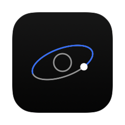

# Orbit

macOS menu bar app showing session and weekly usage for Claude, Codex, and Antigravity, with reset times, across as many accounts per provider as you sign in to, plus daily token counts read from local logs.

## Build and run

    ./scripts/build-app.sh
    open build/Orbit.app

Disk image for installing (rebuilds the app, then writes `build/Orbit-<version>.dmg`; open it and drag Orbit onto Applications):

    ./scripts/build-dmg.sh

Use `./scripts/build-dmg.sh --open` to mount the image and open its drag-to-Applications window after building.

Every push to `main` builds the disk image in GitHub Actions and publishes it as a release (`v<version>.<run>`) listing the commits since the previous one. The latest is on the repository's Releases page.

## Updates

Orbit checks for a newer stable release on startup and every 24 hours while running, including after waking from sleep. **Check for updates** retries immediately. Checks use GitHub's public API without authentication. Network failures appear in Settings without interrupting usage refreshes; an available update puts a blue dot on the header's buttons and an **Update to …** button in Settings.

When available, **Update & restart** downloads the release disk image over HTTPS from the public GitHub release, verifies GitHub's SHA-256 asset digest, checks the bundled app identity, version and code signature, then stages it beside the installed app. Orbit quits, replaces the app and relaunches at the same path. The installer restores the previous app if replacement or the launch request fails. It requires a writable app and parent folder; move the app out of its disk image into Applications first. No administrator prompt is requested. A successful launch request does not detect subsequent crashes.

CI stamps the full `<version>.<run>` into the app so successive releases compare correctly. Older releases without matching bundle versions cannot be installed by the updater. Local builds keep the version from `Resources/Info.plist`; `ORBIT_RELEASE_VERSION` overrides it for release builds. Update metadata stays in memory. Temporary downloads and the previous app are removed after installation; a failed rollback preserves the backup in the adjacent `.Orbit-update-*` directory. No new dependencies are required.

The app is Apple silicon only, ad-hoc signed and not notarized. After installing a downloaded image, the first launch is blocked; allow it under System Settings > Privacy & Security > Open Anyway, or run `xattr -dr com.apple.quarantine /Applications/Orbit.app`.

Start at login (LaunchAgent that opens `build/Orbit.app`; `--remove` uninstalls):

    ./scripts/install-login-item.sh

Native AppKit menu bar app with a SwiftUI dashboard styled after Sideline (dark native popover material). The panel has one tab per provider (Command-1, 2 and 3; the last one stays selected across launches). A tab shows a card per account with session and weekly meters, grey until a quota reaches 70% (orange) or 90% (red), then the provider's tokens. The header shows the last update next to refresh and settings buttons. Settings (gear or Command-,) cross-fades the tab into a grouped form with **Language** (System, English or Português (Brasil); Orbit restarts to switch), size, **Blur** (how opaque the popover blur is; all the way left shows the desktop sharp behind the material tint) and **Darkness** (black over it, up to 90%) sliders, the same pair as Sideline, updates, privacy and quit; it closes with the popover. No Dock icon. It refreshes every 5 minutes and when you open the popover (at most once a minute). Claude requests reuse a five-minute in-memory cache per account; refreshes and popover opens respect its rate-limit cooldown. Animations respect macOS Reduce Motion. Escape or an outside click dismisses the popover; Command-R refreshes, Command-= and Command-minus change the size, and Command-Q quits.

The dashboard grows to fit the selected tab, including connection errors, within the current display's usable area; switching tabs resizes it. The Size option in Settings offers S (85%), M (100%), L (115%) and XL (130%) of the 460 pt panel and remembers the selection (earlier Normal/Larger/Largest choices carry over as M/L/XL). On shorter displays the tab scrolls with an overlay scroll bar that shows only while scrolling, in its own lane clear of the percentages; the header and tabs stay put.

Click a provider's name and external-link icon to open its usage page in your default browser. Links remain available while connecting or when quota refresh fails.

Render a preview without accessing credentials or provider APIs:

    build/Orbit.app/Contents/MacOS/Orbit --snapshot /tmp/orbit-preview.png --demo

Add `--tab claude`, `--tab codex` or `--tab antigravity` to pick the tab, `--settings` for Settings, or `--configure` for that tab's Configure sheet (`--add` opens its form). `--demo` shows two accounts per provider and sample token bars and changes no saved setting. Add `-language pt-BR -AppleLanguages '(pt-BR)'` to render it in Portuguese. Add `--size small`, `--size normal`, `--size larger`, or `--size largest` to preview a specific dashboard size without changing the saved preference.

Omit `--demo` to render live usage. `--dump` prints live quota data for every account. `--tokens` prints each provider's session and 7-day token totals from local logs, without touching credentials or the network; with no quota data there, its session is the rolling 5 hours.

## Language

Orbit speaks English and Português (Brasil). Settings > Language picks System (the macOS language), English or Português (Brasil) and restarts the app. Translations live in `Localization/pt-BR.lproj/Localizable.strings`, keyed by the English text; `scripts/build-app.sh` copies them into the bundle. Dates and times follow the chosen language. In Portuguese, provider messages that still arrive in English (errors from the Claude API or the Codex CLI) are translated on your Mac by Apple's Translation on macOS 15 and later; macOS may ask once to download the language. On macOS 13 and 14 they stay in English.

## App icon

The app icon is a planet with its orbit on a near-black tile, the used part of the orbit lit in blue with the satellite at its tip. `scripts/icon.swift` draws it; the build script compiles and runs it to bundle `AppIcon.icns`. Regenerate the README logo with `swiftc -o build/icon scripts/icon.swift && build/icon build/AppIcon.icns docs/logo.png`. The menu bar draws the same planet and orbit in white (`Sources/Orbit/OrbitIcon.swift`), the used arc solid and the rest dimmed, as a template image that macOS adapts to the menu bar appearance.

## Logos

Drop official logos into `Resources/logos/` as `claude`, `codex`, or `antigravity` with `.svg`, `.pdf`, or `.png`. Without them a letter badge is drawn.

## Accounts

Each provider starts with its default account, the one its tool uses on its own. **Configure** on a tab adds more: give it a name and either a new folder (`~/Library/Application Support/Orbit/<provider>/<UUID>`, created private to you) or an existing one such as `~/.claude-work`. A folder can only be used once per provider. A card that needs signing in links to the same sheet through **Sign in…**.

Install the provider CLI through the linked official instructions, then use **Copy command and open Terminal** and paste the command:

| Provider | Default account | Added account |
|---|---|---|
| Claude | `claude auth login` | `CLAUDE_CONFIG_DIR='<folder>' claude auth login` |
| Codex | `codex login` | `CODEX_HOME='<folder>' codex login` |
| Antigravity | `agy` | `HOME='<folder>' agy` |

Use your Claude subscription for Claude, and **Sign in with ChatGPT** for Codex: API keys have no subscription quota windows. After sign-in, click **Check connections**. The popover stays open while the sheet is up, so you can go to Terminal and back.

Authentication and token storage remain with the provider tools. Orbit does not ask for passwords, tokens or browser cookies. It stores only each account's name and folder path, in its preferences. The default account can be renamed but not removed. **Remove** only takes an account out of Orbit's list: its folder and sign-in stay on your Mac, including a folder Orbit created. macOS may ask for Keychain access the first time Orbit reads an added Claude account.

## Tokens

Each tab shows the tokens used this session, in the last 7 days, and per local day. Tokens are per provider across all its accounts, because the logs don't say which account wrote them. A token here is input + output + cache writes; cache reads don't count.

"This session" means the current 5-hour quota window and resets with the quota: it starts at the earliest start among the provider's active session windows (`resetsAt` minus the window length; Codex reports its length), or the last 5 hours when none is active.

Orbit reads only files changed since the first of those 7 days, in the background, and keeps per-file results in memory so unchanged files aren't reread. It reads numeric usage fields, ids and timestamps; message content is never kept or logged.

- **Claude**: `<config folder>/projects/**/*.jsonl`. The same message repeats across lines and files, so each message and request id counts once. Folders that resolve to the same place are scanned once.
- **Codex**: `<CODEX_HOME>/sessions/**/*.jsonl` and `<CODEX_HOME>/archived_sessions/`. Totals are cumulative per file, so Orbit counts positive changes of total minus cached tokens. A forked session that replays its history can overcount.
- **Antigravity**: no readable counts, so the tab says so.

## Data sources

- **Claude**: OAuth token from the `Claude Code-credentials` Keychain item (or `~/.claude/.credentials.json`). An added account uses `Claude Code-credentials-<first 8 hex characters of the SHA-256 of its folder path>` (or `<folder>/.credentials.json`), as Claude Code names it. Then `GET https://api.anthropic.com/api/oauth/usage`. Undocumented endpoint; may change. The first run may prompt for Keychain access. Responses are cached for five minutes. HTTP 429 triggers exponential backoff from five minutes to one hour, honoring longer `Retry-After` seconds or HTTP dates; zero or invalid headers never allow immediate retries. Last good values and their fetch time remain visible during temporary failures. Server-side throttling can still occur, especially when other tools share the account.
- **Codex**: installed `codex app-server`, using the documented `account/read` and `account/rateLimits/read` methods. Reads current account quotas without starting an inference turn. Codex owns Keychain/file authentication and token refresh. Orbit uses the `codex` quota bucket when available and maps windows by duration, including weekly-only responses. Requires a current Codex CLI; quotas have no stale session-log fallback.
- **Antigravity**: runs `agy -p /usage` (Antigravity CLI, looked up in `~/.local/bin`, `/opt/homebrew/bin`, `/usr/local/bin`) and shows the most used model group per window.

Provider executables are discovered in standard installation locations, mise's shims directory (`~/.local/share/mise/shims`, respecting `MISE_DATA_DIR` and `XDG_DATA_HOME`), and the inherited `PATH`. This works when Orbit is launched from Finder without shell initialization. Claude's credentials remain in the same Keychain/file locations regardless of its install manager. Provider errors do not expose credentials or raw account responses. Credential/account access audit events write status and provider names to stdout without tokens, emails, account names, paths or quota values.

## Privacy

The app has no analytics or tracking. See [the draft privacy notice](Resources/Privacy.txt) for local data access, provider requests, retention and rights. The data controller is Kielblock Dev, represented by Pedro Kielblock; privacy contact: pedro@kielblock.dev. Lawful bases, the controller address and any required DPO designation need maintainer review before distribution.

## License

[MIT](LICENSE)
